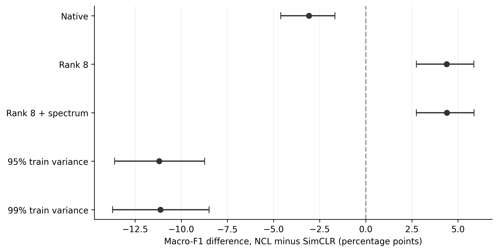
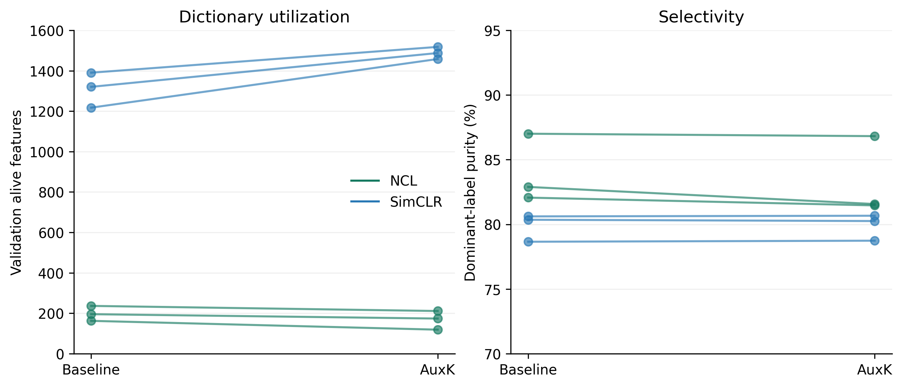

# Representation Geometry and Sparse Autoencoder Feature Selectivity in Brain MRI

Anonymous authors | Venue-neutral research draft

## Abstract

Sparse autoencoder (SAE) feature selectivity can be confounded by representation geometry and dictionary utilization. We examine this issue in brain-MRI FLAIR representations learned with nonnegative contrastive learning (NCL) and SimCLR, using three encoder seeds and three SAE seeds per encoder. Encoders use 1,059 training patient groups; all reported evaluations use 37 validation patients. We separately measure dominant-label selectivity, reconstruction, utilization, predictive performance and within-encoder feature stability, with train-only rank, covariance-spectrum and retained-variance controls. Native NCL SAEs show higher average label purity than SimCLR (83.99% versus 79.87%), but lower raw-embedding probe macro-F1 (84.80% versus 87.88%). The selectivity advantage attenuates under spectrum matching and persists on average at comparable retained variance, while predictive utility favors SimCLR at the 95% and 99% retention targets. An adapted AuxK intervention improves SimCLR utilization but does not alleviate NCL's low utilization, and feature matching does not show an NCL stability advantage. These exploratory validation results demonstrate a selectivity-utility trade-off and motivate evaluating SAE explanations through multiple measurements rather than purity or alive-feature counts alone. 

## 1  Introduction

A sparse autoencoder (SAE) can associate a feature with a tumour label without isolating a tumour-specific concept. A small utilized dictionary may reflect training inactivity or low-dimensional representations, while low unnormalized reconstruction error can reflect low input variance. These distinctions are especially important when brain shape, slice position and tumour labels are correlated.

We study nonnegative contrastive learning (NCL) and SimCLR in an expanded BraTS-derived FLAIR cohort. Our contribution is a controlled empirical evaluation, not a new NCL algorithm or SAE architecture. We jointly examine dictionary utilization, dominant-label selectivity, predictive utility and feature reproducibility, using multiple encoder and SAE seeds and training-only geometry controls. The central result is a selectivity-utility trade-off rather than overall superiority.

## 2  Related work

SimCLR provides an unconstrained contrastive baseline [1]. NCL imposes nonnegativity at the projector output [2]; importantly, our SAE inputs are backbone CLS embeddings before this output. Projector-space interpretation guarantees therefore do not directly apply. Contrastive learning can exhibit dimensional collapse without constant outputs [4]. Top-K SAE work motivates dead-latent mitigation [3], while seed dependence [5] and multidimensional benchmarking [7] caution against interpreting reconstruction or purity alone. Whitening [6] and recent activation shaping [8] further motivate geometry controls; our PCA/spectrum transformations do not reproduce all their methods.

## 3  Data and evaluation

The registered expanded BraTS-derived cohort [9] contains 1,059 training patient groups (138,399 FLAIR slices), 37 validation patients (4,761 slices), and 37 held-out test patients (4,821 slices). Patient identifiers do not cross manifest partitions. All reported evaluations concern the previously inspected validation cohort; the held-out split is not evaluated. The binary probe labels contain 2,373 negative and 2,388 positive validation slices.

NCL and SimCLR share the contrastive setup, with NCL adding a terminal ReLU to the projector. Both expose 192-dimensional backbone CLS vectors. Encoder seeds are 10, 42 and 52, trained for 50 epochs. Each encoder has three SAE seeds with 30 epochs, dictionary size D=1,536 and primary K=24; K=8 is supplementary. Encoder and SAE learning rates are 0.0005. The original supervised reference uses a different supervision/augmentation regime and is not an isolated architectural ablation.

SAEs use training-mean-centered embeddings. Alive means positive activation on at least one evaluated slice; selectivity eligibility requires at least ten. For each eligible unit, purity is the largest dominant-label fraction among its ten most activating slices. The patient-distinct variant permits one slice per original patient. Slice-label shuffles are descriptive reference levels, not patient-independent tests.

Fixed raw-embedding probes use training-only StandardScaler followed by logistic regression (C=1, maximum 2,000 iterations). We report macro-F1, balanced accuracy, class metrics, AUROC and average precision. No threshold tuning or class reweighting is performed. These are slice tumour-presence probes, not patient diagnoses or SAE-code utility measurements.

## 4  Geometry and selectivity

We evaluate native inputs, rank-8 PCA, rank-8 training-spectrum matching, and minimum training PCA dimensions retaining at least 95% or 99% variance. The 95% target is primary and 99% is a sensitivity analysis; both are reported. Spectrum matching rescales retained components to the corresponding NCL training eigenvalues, not their semantic directions. NCL rank-8 and spectrum-matched inputs coincide and must not be counted as independent confirmations.

| Condition | Method | Ranks 10/42/52 | Purity (%) | PCA val. EV (%) |
| --- | --- | --- | --- | --- |
| Native | NCL | 192/192/192 | 83.99 ± 2.65 | 100.00 ± 0.00 |
| Native | SimCLR | 192/192/192 | 79.87 ± 1.06 | 100.00 ± 0.00 |
| Rank 8 | NCL | 8/8/8 | 83.14 ± 2.31 | 98.45 ± 2.41 |
| Rank 8 | SimCLR | 8/8/8 | 82.22 ± 1.25 | 35.02 ± 9.65 |
| Rank 8 + spectrum | NCL | 8/8/8 | 83.14 ± 2.31 | 98.45 ± 2.41 |
| Rank 8 + spectrum | SimCLR | 8/8/8 | 81.10 ± 1.29 | 35.02 ± 9.65 |
| 95% train variance | NCL | 8/3/3 | 83.31 ± 2.60 | 96.14 ± 0.41 |
| 95% train variance | SimCLR | 74/60/90 | 79.61 ± 1.03 | 94.89 ± 0.08 |
| 99% train variance | NCL | 11/4/6 | 84.81 ± 1.83 | 99.08 ± 0.32 |
| 99% train variance | SimCLR | 95/90/121 | 79.69 ± 1.04 | 98.98 ± 0.07 |
Table 1. Mean +/- sample SD across encoder means. Dimensions are fitted on training only. PCA validation EV quantifies retained information in variance units, not diagnostic information.

Native purity is 83.99% for NCL versus 79.87% for SimCLR. The gap shrinks to 0.93 points at rank 8 and 2.04 with spectrum matching. Equal rank is not equal retention: rank 8 preserves 98.45% of NCL validation variance but 35.02% of SimCLR variance. At 99% training retention, validation retention is similar (99.08% versus 98.98%) and NCL purity remains higher (84.81% versus 79.69%). At 95%, NCL leads in only two of three encoders.

## 5  Predictive utility

| Condition | Method | Macro-F1 (%) | Bal. acc. (%) | AUROC |
| --- | --- | --- | --- | --- |
| Native | NCL | 84.80 ± 3.75 | 84.85 ± 3.77 | 0.930 ± 0.027 |
| Native | SimCLR | 87.88 ± 0.33 | 87.93 ± 0.32 | 0.951 ± 0.005 |
| Rank 8 | NCL | 80.75 ± 7.80 | 80.86 ± 7.83 | 0.896 ± 0.059 |
| Rank 8 | SimCLR | 76.36 ± 4.97 | 76.44 ± 5.02 | 0.860 ± 0.049 |
| Rank 8 + spectrum | NCL | 80.75 ± 7.80 | 80.86 ± 7.83 | 0.896 ± 0.059 |
| Rank 8 + spectrum | SimCLR | 76.36 ± 4.96 | 76.44 ± 5.01 | 0.860 ± 0.049 |
| 95% train variance | NCL | 75.43 ± 10.58 | 75.58 ± 10.60 | 0.817 ± 0.123 |
| 95% train variance | SimCLR | 86.62 ± 0.60 | 86.71 ± 0.58 | 0.939 ± 0.008 |
| 99% train variance | NCL | 75.88 ± 9.25 | 75.94 ± 9.32 | 0.855 ± 0.078 |
| 99% train variance | SimCLR | 87.01 ± 0.49 | 87.08 ± 0.47 | 0.943 ± 0.006 |
Table 2. Current refitted raw-embedding probes. Mean +/- sample SD across three encoders. Historical supervised probes are kept separately in the supplement.

Native SimCLR exceeds NCL in macro-F1 (87.88% versus 84.80%) and in balanced accuracy, recall, AUROC and average precision. Rank-8 compression reverses average macro-F1 (80.75% NCL versus 76.36% SimCLR), but discards far more SimCLR variance. At 99% retained variance, macro-F1 is 75.88% for NCL versus 87.01% for SimCLR. Thus improved label selectivity does not imply improved predictive utility, and the ranking depends on the compression constraint.

## 6  AuxK and feature reproducibility

To test one dead-latent intervention, we compare matched native baseline/AuxK dictionaries. The auxiliary objective reconstructs a detached main residual with positive activations among inactive units, using auxiliary K=192, coefficient 1/32 and a one-training-pass inactivity window. Initialization and decoder normalization are unchanged in both arms. This is an adapted loss ablation, not the full Gao training recipe [3].

| Method | Variant | Val. alive | Purity (%) | P-dist. purity (%) |
| --- | --- | --- | --- | --- |
| NCL | Baseline | 198.0 ± 37.1 | 83.99 ± 2.65 | 78.84 ± 1.83 |
| NCL | AuxK | 167.8 ± 46.4 | 83.28 ± 3.06 | 78.33 ± 1.36 |
| SimCLR | Baseline | 1309.3 ± 87.0 | 79.87 ± 1.06 | 73.37 ± 1.28 |
| SimCLR | AuxK | 1487.9 ± 30.0 | 79.88 ± 1.02 | 73.53 ± 1.27 |
Table 3. Matched native SAE intervention. Mean +/- sample SD across three encoder means.

NCL utilization falls from 198 to 168 validation-alive units, while SimCLR rises from 1,309 to 1,488. Auxiliary activations are recorded, yet NCL training inactivity increases. NCL retains a purity advantage, but this does not make inactive features benign or rule out other optimization controls.

For reproducibility, we align eligible SAE features by activation correlation on 4,096 patient-balanced training slices without labels, then assess frozen matches on validation. All three SAE-seed pairs are averaged within encoder. Baseline matched correlation is 0.669 for NCL and 0.710 for SimCLR; AuxK gives 0.669 and 0.678. Coverage, decoder cosine, support Jaccard and random-matching references are provided in the supplement. No NCL stability advantage is demonstrated.

## 7  Uncertainty, limitations and discussion

Reported mean +/- SD uses three encoder means, averaging SAE seeds first when applicable. The same 1,000 whole-patient resamples are used across compared models. Patient-bootstrap intervals condition on the fitted models and training data; they do not include encoder-training uncertainty. Stability pairs share dictionaries and are not independent replications. Top-ten selection and eligibility are discontinuous, so nominal percentile-interval coverage is not guaranteed; feature-count ranges are resampling sensitivity, not population concept-count intervals.

The native purity difference is 4.11 points, with a conditional patient-bootstrap interval [1.02, 5.85]; under AuxK it is 3.40 [0.47, 5.23]. Native macro-F1 instead favors SimCLR by 3.08 points. These intervals are descriptive after repeated validation inspection, not confirmatory evidence from new patients. We report unfavorable seeds and both retained-variance targets rather than selecting the most favorable condition.

Our dominant-label selectivity measure can reflect background/anatomy or slice position rather than tumour-localizing concepts. Coarse CLS-to-patch transfer Dice is not a patch-trained segmentation evaluation and does not establish a general NCL localization advantage. Similar matched directions need not be the same semantic concept. Lower alive counts also do not imply stronger per-input sparsity: both methods activate approximately K units per slice.

Only 37 validation patients support the reported evaluations despite the much larger training cohort. Compatible expanded-run encoder weights and held-out embeddings were not saved; older test caches have another manifest. No held-out or independently verified external evaluation is claimed. Historical supervised accuracy is available, but supervised macro-F1/AUROC was not refitted in the new probe bundle. Current probe outputs differ slightly from historical ones and are presented separately, not silently mixed.

## 8  Conclusion

Nonnegative contrastive training is associated with higher average SAE dominant-label selectivity in this setting, but selectivity, utilization, feature stability and predictive utility do not improve together. Rank, spectrum and retained-variance controls expose sensitivity rather than establish an overall winner. The evidence supports a qualified empirical selectivity-utility trade-off, not diagnostic superiority, causal disentanglement or external generalization.

## References

[1] T. Chen, S. Kornblith, M. Norouzi and G. Hinton. A Simple Framework for Contrastive Learning of Visual Representations. ICML, 2020.

[2] Y. Wang, Q. Zhang, Y. Guo and Y. Wang. Non-negative Contrastive Learning. ICLR, 2024. arXiv:2403.12459.

[3] L. Gao et al. Scaling and evaluating sparse autoencoders. arXiv:2406.04093, 2024.

[4] L. Jing, P. Vincent, Y. LeCun and Y. Tian. Understanding Dimensional Collapse in Contrastive Self-supervised Learning. ICLR, 2022. arXiv:2110.09348.

[5] G. Paulo and N. Belrose. Sparse Autoencoders Trained on the Same Data Learn Different Features. arXiv:2501.16615, 2025.

[6] A. Saraswatula and D. Klindt. Data Whitening Improves Sparse Autoencoder Learning. arXiv:2511.13981, 2025.

[7] A. Karvonen et al. SAEBench: A Comprehensive Benchmark for Sparse Autoencoders in Language Model Interpretability. arXiv:2503.09532, 2025.

[8] O. Delafrooz Noroozi, B. Puranik and U. Madhow. Shaped SAEs: Expanding the Toolkit for Mechanistic Interpretability. arXiv:2610.27375, October 2026 preprint.

[9] B. H. Menze et al. The Multimodal Brain Tumor Image Segmentation Benchmark (BRATS). IEEE Transactions on Medical Imaging, 34(10):1993-2024, 2015.
