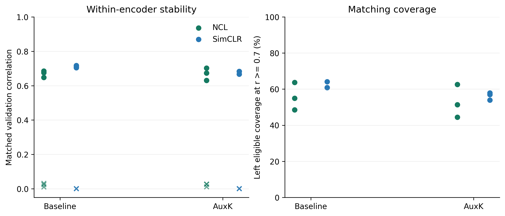

# Supplementary material

Representation Geometry and Sparse Autoencoder Feature Selectivity in Brain MRI

## S1  Dataset and experimental protocol

| split | patient_groups | slice_samples |
| --- | --- | --- |
| test | 37 | 4821 |
| train | 1059 | 138399 |
| val | 37 | 4761 |
Table S1. Registered patient-group and slice counts; only validation was evaluated.

All stages use manifest eb3157a33d1240588e068e551ce352a97f39e009d09cec08ad288eb986fa6928. The shared embedding bundle checksum is e41d4ae24932127a5747073d7225bdfd2d20022ca8a22027222674b7494cf9eb. Input identities are verified before transform fitting. Training mean, PCA covariance and spectra are not fitted to validation.

## S2  Definitions and aggregation

For unit j, purity is max_c count(c among Top10(j))/10, with at least ten positive slice activations required. Patient-distinct purity uses one slice per original patient and requires ten distinct positively activating patients. Mean purity averages eligible units; coverage is reported separately. Dominant-label frequencies and binary slice counts are supplied as machine-readable tables.

Reconstruction EV is 1 minus squared reconstruction error divided by squared deviation from the training mean. PCA controls report both transformed-coordinate EV and inverse-transformed original-coordinate EV. Small absolute MSE across representations is not an interpretable fidelity comparison by itself. Rank is selected from training eigenvalues, and fractional targets can overshoot.

AuxK dead status is based on examples since positive main activation; auxiliary activity does not reset it. The auxiliary target is detached, with no decoder bias in auxiliary reconstruction. Logs include positive auxiliary activations, inactivity ages and training-alive counts. The adaptation is not a full canonical initialization/normalization comparison.

Probes are training-fitted StandardScaler plus unweighted logistic regression, C=1, max_iter=2000. Tumour probability corresponds to class 1. Macro-F1 includes both labels. AUPRC means average precision, not trapezoidal integration. Zero-denominator precision/F1 uses zero; single-class resamples have missing AUROC/balanced accuracy, and no-positive resamples have missing average precision. Bounds are suppressed if fewer than 95% of replicates are finite.

## S3  Native dictionaries and supervised reference

| Method | Alive | Eligible | Purity (%) | Purity-shuffle | EV (%) |
| --- | --- | --- | --- | --- | --- |
| Supervised | 424.1 ± 86.5 | 374.9 ± 83.6 | 79.82 ± 0.46 | 23.93 ± 0.47 | 99.862 ± 0.061 |
| SimCLR | 1309.3 ± 87.0 | 1238.1 ± 77.5 | 79.87 ± 1.06 | 24.01 ± 1.09 | 99.687 ± 0.032 |
| NCL | 198.0 ± 37.1 | 132.7 ± 41.8 | 83.99 ± 2.65 | 28.21 ± 2.61 | 99.941 ± 0.050 |
Table S2. Native K=24 SAEs. Mean +/- SD across encoder means. The shuffle is descriptive; supervised differs in labels and augmentation.

## S4  Historical probe and spatial measurements

Historical probes from the original three-method experiment are not NB25 refits. They provide the supervised accuracy reference but not a matched new three-way F1/AUROC comparison. Their exact per-seed values and effective ranks are supplied in the accompanying tables. Small native accuracy shifts are not hidden: the current predictive tables consistently use NB25.

The original K=8/K=24 spatial evaluation transfers a CLS-trained SAE to patches using the CLS training mean. This spatial mismatch and the coarse patch representation restrict interpretation. Candidate-count differences affect maxima; use the full alive-feature mean and the predefined selected-feature diagnostic rather than presenting a best-feature maximum as a fair method comparison. Exact original per-encoder Dice and K=8 values remain in machine-readable Table S3.

## S5  Interpretation boundaries

High top-ten label purity is not proof of localized tumour structure, and a dictionary unit is not a biological mechanism. Supervised is not a matched architecture-only control. The revised package does not reuse the original submission's single-run 44/499 counts or old dataset results. Unverified exploratory external-cohort results are excluded.

## S6  Training-only geometry controls

| Condition | Method | Rank 10/42/52 | P-dist. purity (%) | Original EV (%) |
| --- | --- | --- | --- | --- |
| Native | NCL | 192/192/192 | 78.84 ± 1.83 | 99.94 ± 0.05 |
| Native | SimCLR | 192/192/192 | 73.37 ± 1.28 | 99.69 ± 0.03 |
| Rank 8 | NCL | 8/8/8 | 78.62 ± 1.32 | 98.45 ± 2.41 |
| Rank 8 | SimCLR | 8/8/8 | 74.40 ± 1.63 | 34.99 ± 9.66 |
| Rank 8 + spectrum | NCL | 8/8/8 | 78.62 ± 1.32 | 98.45 ± 2.41 |
| Rank 8 + spectrum | SimCLR | 8/8/8 | 74.30 ± 1.39 | 34.92 ± 9.53 |
| 95% train variance | NCL | 8/3/3 | 77.74 ± 3.60 | 96.14 ± 0.41 |
| 95% train variance | SimCLR | 74/60/90 | 72.45 ± 1.49 | 94.66 ± 0.10 |
| 99% train variance | NCL | 11/4/6 | 80.12 ± 2.87 | 99.07 ± 0.31 |
| 99% train variance | SimCLR | 95/90/121 | 72.82 ± 1.15 | 98.71 ± 0.09 |
Table S4. Mean +/- SD across encoder means; ranks are listed in encoder-seed order 10/42/52.

At the 95% target, selected dimensions are NCL 8/3/3 and SimCLR 74/60/90; at 99%, they are 11/4/6 and 95/90/121. A common threshold does not force identical actual fractions, validation retention or semantic information. Both targets were fixed for this sensitivity experiment before their outcomes were inspected.

Spectrum matching equates retained training eigenvalues and trace for each encoder seed but not eigenvectors or diagnostic content. Because NCL supplies the target spectrum, its matched case duplicates its rank-only transform. That duplicate is labeled but not interpreted as an independent replication. The rank-only NCL purity advantage does not hold for every encoder; 95% retained-variance purity also slightly favors SimCLR for seed 52.

## S7  Feature stability

| Method | Variant | Val. r | Random r | Decoder cos. | Jaccard |
| --- | --- | --- | --- | --- | --- |
| NCL | Baseline | 0.669 ± 0.020 | 0.022 ± 0.011 | 0.374 ± 0.027 | 0.423 ± 0.050 |
| NCL | AuxK | 0.669 ± 0.036 | 0.022 ± 0.009 | 0.384 ± 0.027 | 0.435 ± 0.059 |
| SimCLR | Baseline | 0.710 ± 0.006 | 0.001 ± 0.000 | 0.653 ± 0.018 | 0.414 ± 0.011 |
| SimCLR | AuxK | 0.678 ± 0.009 | 0.001 ± 0.000 | 0.641 ± 0.015 | 0.397 ± 0.006 |
Table S5. Mean +/- sample SD across encoder means. Full directional coverage and 0.9 threshold results accompany the source data.

At most 4,096 training slices are selected by patient-balanced round robin, without labels. Eligibility requires at least ten positive subset examples and nonzero training variance. Rectangular assignment maximizes training activation correlation; surplus units remain unmatched. Frozen matches are evaluated by validation correlation, activation support Jaccard and decoder cosine. Constant validation units have undefined correlation and remain visible in variable-match counts. Thresholds 0.7 and 0.9 are reported as sensitivities, not validated clinical standards.

## S8  Conditional patient intervals

| Outcome | Condition | Metric | Difference (pp) | Patient interval |
| --- | --- | --- | --- | --- |
| Selectivity | Baseline | mean_purity | 4.11 | [1.02, 5.85] |
| Selectivity | Baseline | patient_distinct_purity | 5.47 | [2.57, 6.36] |
| Selectivity | AuxK | mean_purity | 3.40 | [0.47, 5.23] |
| Selectivity | AuxK | patient_distinct_purity | 4.80 | [1.57, 5.30] |
| Prediction | Native | macro_f1 | -3.08 | [-4.61, -1.67] |
| Prediction | Rank 8 | macro_f1 | 4.39 | [2.75, 5.86] |
| Prediction | Rank 8 + spectrum | macro_f1 | 4.39 | [2.75, 5.87] |
| Prediction | 95% train variance | macro_f1 | -11.19 | [-13.61, -8.73] |
| Prediction | 99% train variance | macro_f1 | -11.13 | [-13.73, -8.49] |
Table S6. NCL minus SimCLR in percentage points. Conditional 95% percentile intervals from 1,000 common whole-patient bootstrap draws. No held-out or multiplicity-adjusted inference is claimed.

Each draw resamples patient identities and retains all their slices, including multiplicity. For selectivity, eligibility and top-ten lists are recomputed. Patient-distinct selection deduplicates original identity. For probe outcomes, weighted confusion counts and probability-ranking metrics are recomputed. SAE seeds are averaged within encoder before aggregation. Fixed encoder/probe training and prior validation inspection are not accounted for by these intervals.

## S9  Reproducibility and remaining scope

The source package includes editable text, bibliography, plots, tables, metric definitions, environment/source manifests for author review and the core analysis runtimes. It does not redistribute MRI images, private credentials or model/data archives. All input/result identities are pinned by checksums in the author evidence package. Missing encoder weights prevent reconstructing current-run test embeddings from images. No additional training or test evaluation occurred when preparing this submission draft.
